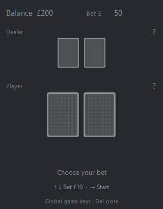
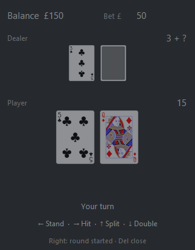

# Blackjack Overlay

**A compact, always-on-top blackjack table for your desktop.**

Play a hand with keyboard controls, keep the overlay out of the way, and follow
the cards as they deal and flip.

*The table opens with the cards face down. Choose a wager before starting the hand.*

## Features

- Small, frameless **320 × 410** window that stays on top and can be dragged.
- Animated card dealing, flips, reveals, and hand layout.
- Keyboard play, including global controls on Windows.
- Betting, split hands, double down, and automatic dealer play.
- 52 card faces and a card back bundled locally; no network access or runtime
  image libraries required.

## Screenshots

| Waiting to deal | Player's turn |
| --- | --- |
|  |  |

## Get started

## Controls

| Key | Betting / between hands | Your turn |
| --- | --- | --- |
| **Right** | Start the hand and reveal the opening cards | Hit |
| **Left** | No action | Stand |
| **Up** | Increase the next bet by £10 | Split a matching pair, if allowed |
| **Down** | Decrease the next bet by £10 | Double down, if allowed |
| **Delete** | Close the overlay | Close the overlay |

The bet is limited to £1 through the available balance. The starting balance is
£200 in play money and resets on restart. After a result, the next hand is
prepared face down after four seconds; it does not start until **Right** is
pressed.

## Rules

- The dealer stands on all 17s. Aces count as 1 or 11 to avoid a bust.
- Wins pay 1:1; a push returns the wager.
- A matching pair can be split once, with an equal second wager.
- Split aces receive one card each. They cannot be hit or doubled.
- Double down matches the hand's wager and draws exactly one card.
- There is no insurance or automated player decision-making.

## Background keys and diagnostics

On Windows, the app requests global hotkeys for **Right, Left, Up, Down, and
Delete**. If registration fails for a key, it tries a low-level event filter
for that key. If neither mechanism works, focus the overlay to use that key.
Windows desktop security restrictions can prevent background key delivery;
global-key availability is not guaranteed on every desktop.

The app periodically writes `input-diagnostics.json` beside the running app.
It contains runtime and authorized-control diagnostics for those five keys; it
does not record arbitrary keyboard input. Diagnostic files are local and are
excluded from version control.

## Card artwork

The standard playing-card SVGs are by Adrian Kennard (RevK), sourced from
[me.uk/cards](https://www.me.uk/cards/). The original artwork is dedicated to
the public domain under **CC0 1.0**. The unmodified SVGs, full license text,
and source-to-image mapping are included in [`assets/`](assets/):

- [`assets/ATTRIBUTION.md`](assets/ATTRIBUTION.md)
- [`assets/LICENSE.txt`](assets/LICENSE.txt)

## Project files

- `gui.py` — Tkinter overlay and game flow
- `hotkeys.py` — Windows keyboard handling
- `deck.py`, `hand.py`, `player.py` — card, hand, and player models
- `assets/cards/` — card images used by the app
- `assets/svg/` — original SVG artwork
- `main.py` — supplied console blackjack example
